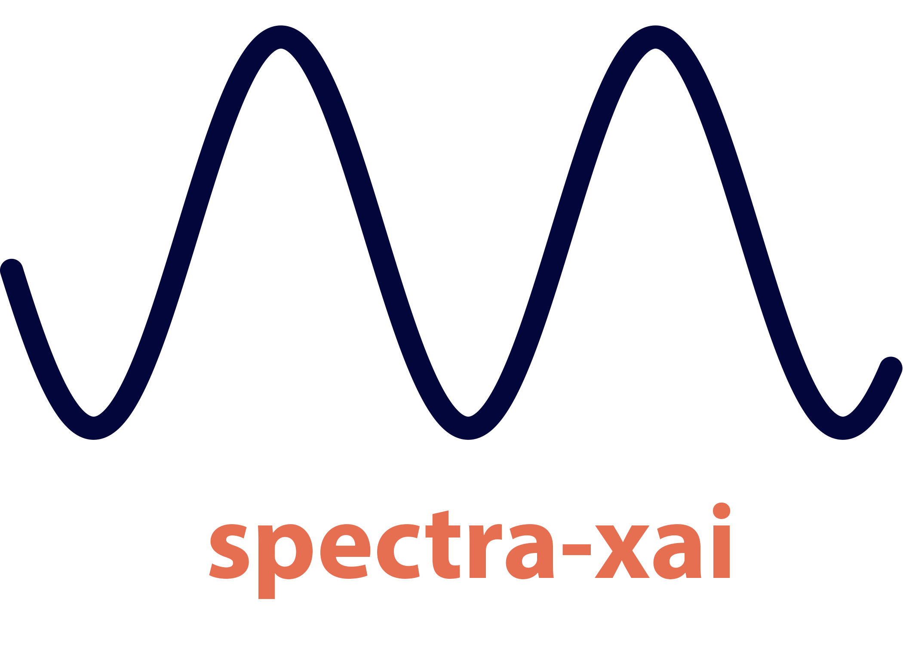

<!--
SPDX-FileCopyrightText: 2026 Nikos Tsakiridis <tsakirin@auth.gr>

SPDX-License-Identifier: GPL-3.0-or-later
-->

<a id="readme-top"></a>


[![CI][ci-shield]][ci-url]
[![Issues][issues-shield]][issues-url]
[![License][license-shield]][license-url]


<!-- PROJECT LOGO -->
<br />
<div align="center">
  <a href="https://github.com/tsakiridis/spectra-xai">
    
  </a>

  <h3 align="center">eXplainable Artificial Intelligence for spectral datasets</h3>

  <p align="center">
    An awesome python library to jumpstart your AI models!
    <br />
    <a href="https://tsakiridis.github.io/spectra-xai/spectraxai.html"><strong>Explore the docs »</strong></a>
    <br />
    <br />
    <a href="https://github.com/tsakiridis/spectra-xai/tree/main/examples">View Examples</a>
    &middot;
    <a href="https://github.com/tsakiridis/spectra-xai/issues/new?labels=bug&template=bug-report---.md">Report Bug</a>
    &middot;
    <a href="https://github.com/tsakiridis/spectra-xai/issues/new?labels=enhancement&template=feature-request---.md">Request Feature</a>
  </p>
</div>


<!-- TABLE OF CONTENTS -->
<details>
  <summary>Table of Contents</summary>
  <ol>
    <li>
      <a href="#about-the-project">About The Project</a>
      <ul>
        <li><a href="#built-with">Built With</a></li>
      </ul>
    </li>
    <li>
      <a href="#getting-started">Getting Started</a>
      <ul>
        <li><a href="#prerequisites">Prerequisites</a></li>
        <li><a href="#installation">Installation</a></li>
      </ul>
    </li>
    <li><a href="#whats-new-in-120">What's new in 1.2.0</a></li>
    <li><a href="#usage">Usage</a></li>
    <li>
      <a href="#contributing">Contributing</a>
      <ul>
        <li><a href="#use-of-pre-commit">Use of pre-commit</a></li>
        <li><a href="#running-tests">Running tests</a></li>
        <li><a href="#building-documentation">Building documentation</a></li>
      </ul>      
    </li>
    <li><a href="#license">License</a></li>
    <li><a href="#contact">Contact</a></li>
    <li><a href="#acknowledgments">Acknowledgments</a></li>
  </ol>
</details>


<!-- ABOUT THE PROJECT -->
## About The Project


This library was developed to rapidly prototype and test various AI models across different spectral pre-treatments. It features:

* Spectral pre-processing or pre-treatment (absorbance, SNV, MSC, Savitzky–Golay derivatives, continuum removal, detrending, ...), also as a scikit-learn transformer
* Dataset splitting into training and independent test sets (random, Kennard–Stone, cLHS, cross-validation, stratified)
* Model training and optimization of the algorithms' hyperparameters (PLS, SVR, RF, Cubist, XGBoost, Ridge, Lasso, Elastic Net, kNN, Gaussian processes, MLP, or any scikit-learn regressor), with scikit-learn compatible models
* Feature (wavelength) selection: RFE/RFECV, VIP filtering and pre-hoc rankings
* Pre- and post-hoc explainability analysis: correlograms, feature rankings, VIP, permutation importance, SAGE, SHAP, and plots of importance over the spectrum; every plot accepts a matplotlib `ax` so it can be composed into your own figures

<p align="right">(<a href="#readme-top">back to top</a>)</p>


### Built With

A number of different open source python packages are used like:

[![Numpy][Numpy-shield]][Numpy-url]
[![Scikit][Scikit-shield]][Scikit-url]
[![Pandas][Pandas-shield]][Pandas-url]

<p align="right">(<a href="#readme-top">back to top</a>)</p>


<!-- GETTING STARTED -->
## Getting Started

To get a local copy up and running follow these simple example steps.

### Prerequisites

Python 3.13 or newer is required.

Note that the cubist dependency requires a C compiler; in a Debian-based OS one can install it via:
```
sudo apt install build-essential
```

### Installation

1. On a new conda environment or virtualenv run:
   ```
   git clone https://github.com/tsakiridis/spectra-xai
   cd spectra-xai && pip install .
   ```

2. [Optional] For SHAP-based explanations install the `shap` extra:
    ```
    pip install .[shap]
    ```

3. [Optional] To install the development packages (e.g., if you want to edit this library) use:
    ```
    pip install -e .[dev]
    ```

<p align="right">(<a href="#readme-top">back to top</a>)</p>


<!-- WHAT'S NEW -->
## What's new in 1.2.0

Backwards compatible with 1.1.0, apart from the bug fixes listed in the changelog (which may change numeric results).

* **scikit-learn interface**: `StandardModel` is a scikit-learn regressor and `SpectralPreprocessor` a transformer, so both work in `Pipeline`, `GridSearchCV`, `clone` and PyCaret.
* **More models**: Ridge, Lasso, Elastic Net, kNN, Gaussian processes, MLP, or any scikit-learn regressor via `Model.CUSTOM`.
* **Wavelength selection** (`spectraxai.selection`): `RFE`, `RFECV`, `VIPSelector` and `SelectKBest`, all working on a `Dataset`.
* **New pre-processing**: MSC, detrending and mean centering; stateful steps such as MSC are learned on the training set only.
* **New splits and explanations**: cLHS and quantile-stratified splits; SHAP, SAGE, PLS coefficients, and importance drawn over the mean spectrum.
* **Plots**: every plot accepts `ax=` / `axes=` and keyword arguments, and none changes global matplotlib state.
* **MIR spectra**: `spectral_unit="cm-1"` labels plots in wavenumbers and draws them from high to low; a bundled MIR soil dataset (`load_GB_MIR`).
* **Reproducibility**: `random_state` on models, splits and explanations.
* Requires Python 3.13+ and scikit-learn 1.6+.

See [CHANGELOG.md](CHANGELOG.md) for the full list, including fixes and deprecations.

<p align="right">(<a href="#readme-top">back to top</a>)</p>


<!-- USAGE EXAMPLES -->
## Usage

A short example: compare pre-treatments for PLS on the bundled soil spectral library, keep the most informative wavelengths and plot their importance over the mean spectrum.

```python
from spectraxai.data import load_GR_SSL
from spectraxai.dataset import DatasetSplit
from spectraxai.explain import PostHocAnalysis
from spectraxai.models import Model, StandardModel
from spectraxai.selection import VIPSelector
from spectraxai.spectra import SpectralPreprocessing as SP

dataset = load_GR_SSL()
idx_trn, idx_tst = dataset.train_test_split(DatasetSplit.KENNARD_STONE, 0.8)

pls = StandardModel(Model.PLS, random_state=0)
results = pls.fit_and_predict_multiple(
    dataset, [SP.ABS, [SP.ABS, SP.SNV], [SP.ABS, SP.MSC]], idx_trn=idx_trn
)
print(results[["pre_process", "RMSE", "R2", "RPIQ"]])

absorbance = dataset.preprocess(SP.ABS)
reduced = VIPSelector(n_components=10).fit(absorbance.subset(idx_trn)).transform(absorbance)
pls.fit(reduced.subset(idx_trn))
PostHocAnalysis(reduced).plot_importance_spectrum(pls)
```

More examples may be found under the [examples](examples) folder:

* Scripts:
  * [quickstart.py](examples/quickstart.py): train and test a PLS model and plot its VIP over the mean spectrum
  * [compare_pretreatments.py](examples/compare_pretreatments.py): compare spectral pre-treatments with cross-validation
  * [select_wavelengths.py](examples/select_wavelengths.py): VIP, RFECV and correlation-based wavelength selection
* Notebooks:
  * [modelExamples.ipynb](examples/modelExamples.ipynb): pre-treatments, models, splits, pipelines and feature selection
  * [modelInterpretability.ipynb](examples/modelInterpretability.ipynb): pre- and post-hoc explanations and plots
  * [mirSpectra.ipynb](examples/mirSpectra.ipynb): mid-infrared spectra in wavenumbers (cm⁻¹), with the axis drawn from high to low
  * [pycaretIntegration.ipynb](examples/pycaret/pycaretIntegration.ipynb): spectraxai pipelines and models inside [PyCaret](https://pycaret.org) (requires PyCaret, see the notebook)

### Example datasets

Two datasets are bundled (see `spectraxai.data`):

* `load_GR_SSL()`: vis–NIR reflectance (350–2500 nm) and properties of Greek soils, part of the [GEO-CRADLE](http://datahub.geocradle.eu/dataset/regional-soil-spectral-library) soil spectral library.
* `load_GB_MIR()`: MIR absorbance spectra (4000–400 cm⁻¹) of 427 soils, a subset of Keith, A.M., Dodd, B.A., Turner, G., Vane, C.H., Wood, C.M. (2020). *Soil mid-infrared spectroscopy data from arable and grassland in Countryside Survey, Great Britain 2007*. NERC EIDC, [doi:10.5285/d66ca0a6-403d-4f5a-bef1-8ee177f1e1b3](https://doi.org/10.5285/d66ca0a6-403d-4f5a-bef1-8ee177f1e1b3). Contains public sector information licensed under the Open Government Licence v3.0.

For spectra in wavenumbers pass `spectral_unit="cm-1"` to `Dataset`: plots are then labelled "Wavenumber (cm⁻¹)" and drawn from high to low wavenumber.

See [CHANGELOG.md](CHANGELOG.md) for what changed in each version.

_For more examples, please refer to the [Documentation](https://tsakiridis.github.io/spectra-xai/spectraxai.html)_

<p align="right">(<a href="#readme-top">back to top</a>)</p>


<!-- CONTRIBUTING -->
## Contributing

Contributions are what make the open source community such an amazing place to learn, inspire, and create. Any contributions you make are **greatly appreciated**.

If you have a suggestion that would make this better, please fork the repo and create a pull request. You can also simply open an issue with the tag "enhancement".

1. Fork the Project
2. Create your Feature Branch (`git checkout -b feature/AmazingFeature`)
3. Commit your Changes (`git commit -m 'Add some AmazingFeature'`)
4. Push to the Branch (`git push origin feature/AmazingFeature`)
5. Open a Pull Request


### Use of pre-commit

Please note that a number of different pre-commit hooks are used to automatically keep the project in its proper state.
If you wish to submit a pull request it's recommended to install pre-commit locally and run them, i.e.:

```
pre-commit run --all-files
```

### Running tests

Tests may be run through command line by executing e.g.:

```
pytest --doctest-modules spectraxai tests --cov --cov-report=html
```

The fast unit tests (on synthetic spectra) can be run on their own, skipping the slower integration tests on the bundled dataset:

```
pytest -m "not slow"
```

The example notebooks are checked with:

```
pytest --nbmake --nbmake-kernel=python3 examples/*.ipynb
for script in examples/*.py; do python "$script"; done
```

### Building documentation

Documentation may be generated via:

```
pdoc --docformat numpy --math -o docs spectraxai
```

<p align="right">(<a href="#readme-top">back to top</a>)</p>


<!-- LICENSE -->
## License

This project is licensed under the terms of the **GNU General Public License v3.0 or later (GPL-3.0-or-later)**. See the [LICENSES/](LICENSES/) directory for the full license text and additional license information.

Some files (e.g., documentation) are licensed under the **Creative Commons Attribution-ShareAlike 4.0 International License (CC-BY-SA-4.0)**. These files are explicitly marked with their respective license headers. The bundled MIR spectra (`spectraxai/data/MIR_GB_CS2007.csv`) are licensed under the **Open Government Licence v3.0 (OGL-UK-3.0)**, see above for the required attribution.

<p align="right">(<a href="#readme-top">back to top</a>)</p>


<!-- CONTACT -->
## Contact

[Nikos Tsakiridis](https://tsakirin.webpages.auth.gr/) - tsakirin@auth.gr

<p align="right">(<a href="#readme-top">back to top</a>)</p>


<!-- ACKNOWLEDGMENTS -->
## Acknowledgments

This library was made possible through funding from the European Union as it was developed within the framework of several research projects, including:
* [EIFFEL](https://www.eiffel4climate.eu/) (European Union’s Horizon 2020 research and innovation programme under Grant Agreement Νο 101003518)
* [Soils4Africa](https://www.soils4africa-h2020.eu/) (European Union’s Horizon 2020 research & innovation programme under Grant Agreement No. 862900)
* [BACCHUS](https://bacchus-project.eu/) (European Union’s Horizon 2020 research and innovation programme under Grant Agreement No 871704)

<p align="right">(<a href="#readme-top">back to top</a>)</p>


<!-- MARKDOWN LINKS & IMAGES -->
<!-- https://www.markdownguide.org/basic-syntax/#reference-style-links -->
[ci-shield]: https://github.com/tsakiridis/spectra-xai/actions/workflows/ci.yml/badge.svg
[ci-url]: https://github.com/tsakiridis/spectra-xai/actions/workflows/ci.yml
[issues-shield]: https://img.shields.io/github/issues/tsakiridis/spectra-xai.svg
[issues-url]: https://github.com/tsakiridis/spectra-xai/issues
[license-shield]: https://img.shields.io/badge/license-GPLv3-blue
[license-url]: https://github.com/tsakiridis/spectra-xai/blob/main/LICENSES/GPL-3.0-or-later.txt
[Scikit-shield]: https://img.shields.io/badge/scikit%20learn-F7931E?style=for-the-badge&logo=scikit-learn&logoColor=white
[Scikit-url]: https://github.com/scikit-learn/scikit-learn
[Numpy-shield]: https://img.shields.io/badge/Numpy-777BB4?style=for-the-badge&logo=numpy&logoColor=fff
[Numpy-url]: https://github.com/numpy/numpy
[Pandas-shield]: https://img.shields.io/badge/Pandas-150458?style=for-the-badge&logo=pandas&logoColor=fff
[Pandas-url]: https://github.com/pandas-dev/pandas
